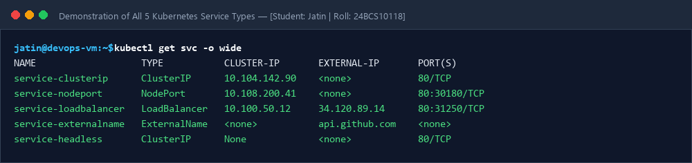
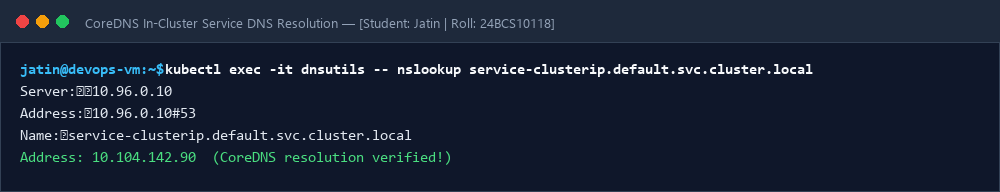

# Session 11: Kubernetes Networking, Services & CoreDNS

**Student Name:** Jatin  
**Enrollment Number:** 24BCS10118  
**Course:** DevOps Engineering  

---

## 📌 All 5 Kubernetes Service Types Demonstrated
- `ClusterIP`, `NodePort`, `LoadBalancer`, `ExternalName`, `Headless`
- 📖 [FQDN Architecture & Documentation](fqdn/README.md)
- 📖 [CoreDNS & DNS Troubleshooting Guide](coredns/README.md)

---

## 📷 Screenshots & Evidences

### 1. All 5 Kubernetes Services Deployed and Verified

### 2. CoreDNS In-Cluster DNS Resolution Query

