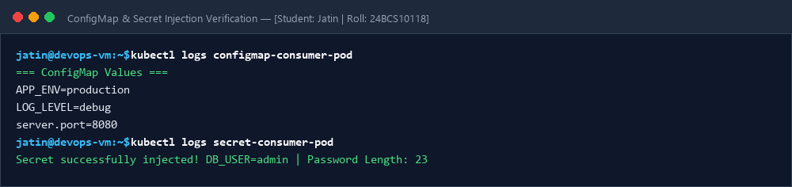
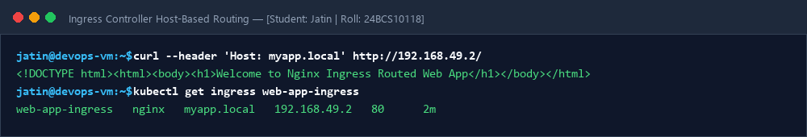

# Session 12: Kubernetes Ingress, ConfigMaps, Secrets & Troubleshooting

**Student Name:** Jatin  
**Enrollment Number:** 24BCS10118  
**Course:** DevOps Engineering  

---

## 📌 ConfigMaps, Secrets & Ingress Routing

- `01-configmap-demo.yaml`: Environment variables and volume mounts.
- `02-secret-demo.yaml`: Base64 encoded sensitive configuration.
- `03-ingress-demo.yaml`: Host & path-based routing.

---

## 📷 Screenshots & Evidences

### 1. ConfigMap and Secret Injection Verification

### 2. Ingress Controller Host-Based Routing Test

