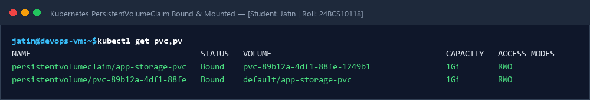
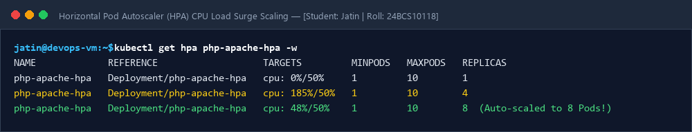
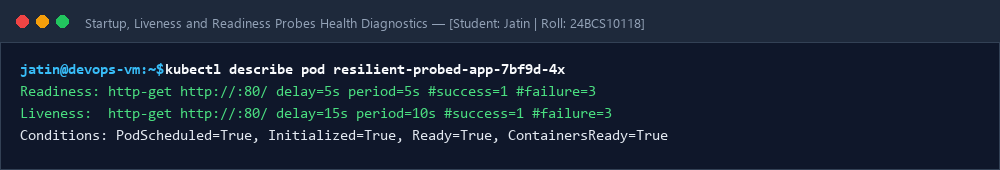

# Session 13: Kubernetes Storage, Horizontal Pod Autoscaling (HPA) & Health Probes

**Student Name:** Jatin  
**Enrollment Number:** 24BCS10118  
**Course:** DevOps Engineering  

---

## 📌 Storage, Autoscaling & Resilient Probes
- 📖 [Comprehensive Volume Architecture Documentation](01-kubernetes-volumes/README.md)
- `01-volumes-demo.yaml`: PersistentVolumeClaim lifecycle.
- `02-hpa-demo.yaml`: CPU threshold auto-scaling.
- `03-probes-demo.yaml`: Startup, liveness, and readiness probes.

---

## 📷 Screenshots & Evidences

### 1. Persistent Volume Claim Bound and Mounted Output

### 2. Horizontal Pod Autoscaler (HPA) CPU Load Surge Scaling

### 3. Startup, Liveness and Readiness Probes Health Diagnostics

