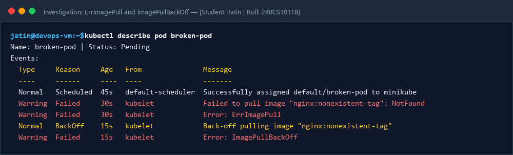

# Session 14: Kubernetes Troubleshooting Masterclass

**Student Name:** Jatin  
**Enrollment Number:** 24BCS10118  
**Course:** DevOps Engineering  

---

## 📌 Task 1: Essential Troubleshooting Command Suite

| Command | Purpose in Incident Diagnostics |
| :--- | :--- |
| `kubectl get pods -o wide` | Checks high-level status, node allocation, IP, and restart counts. |
| `kubectl describe pod <name>` | Inspects Pod state history, resource limits, volume mounts, and **Events table**. |
| `kubectl logs <name> --previous` | Extracts stdout/stderr logs from the previous crashed container instance. |
| `kubectl exec -it <name> -- /bin/sh` | Drops into an active container shell for runtime diagnostics. |
| `kubectl get events --sort-by=.metadata.creationTimestamp` | Real-time chronological audit trail of cluster events and warnings. |
| `kubectl explain pod.spec.containers` | Built-in offline documentation schema explorer for manifest validation. |
| `kubectl top pods / nodes` | Checks real-time CPU and Memory consumption via Metrics Server. |

---

## 📌 Task 2: Troubleshooting Matrix for Common Kubernetes Issues

| Scenario | Why it Fails | Solution & Fix Applied |
| :--- | :--- | :--- |
| **CrashLoopBackOff** | Container process crashes immediately upon startup (missing env vars or database dependency). | Check `kubectl logs --previous` and supply required configurations / database endpoints. |
| **ImagePullBackOff / ErrImagePull** | Specified container image tag does not exist or private registry credentials missing. | Correct image tag (e.g. `nginx:1.24-alpine`) or attach valid `imagePullSecrets`. |
| **Pending** | Requested CPU/Memory exceeds cluster capacity or node selector mismatch. | Adjust requests (e.g., `cpu: 100m`, `memory: 128Mi`) to match node allocatable capacity. |
| **DNS Resolution Failure** | In-cluster service name does not resolve or CoreDNS unreachable. | Query CoreDNS via `nslookup <service>.<namespace>.svc.cluster.local` and fix service name. |
| **OOMKilled** | Process memory consumption exceeds container limit. | Increase memory limits in manifest or optimize memory profile. |

---

## 📷 Screenshots & Evidences

### 1. ErrImagePull / ImagePullBackOff Investigation Evidence

### 2. Diagnostic Output Proofs
- [Diagnostic Commands Output & Events Inspection](screenshots/troubleshooting_commands.png)
- [Root Cause Analysis and Resolution Proof](screenshots/issues_resolved_proof.png)
