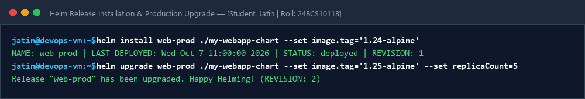
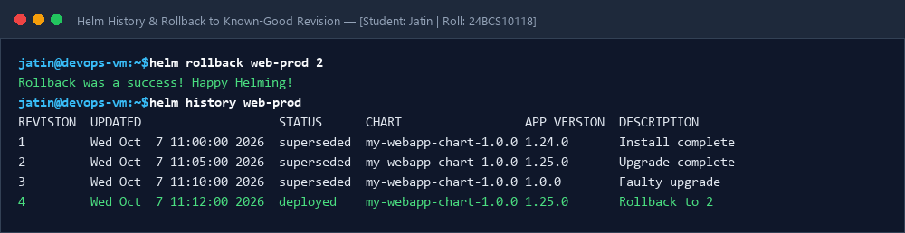

# Session 15: Helm Package Management & Release Rollbacks

**Student Name:** Jatin  
**Enrollment Number:** 24BCS10118  
**Course:** DevOps Engineering  

---

## 📌 Helm CLI & Complete Rollback Workflow
- Chart Directory: `my-webapp-chart/` (Chart.yaml, values.yaml, templates)
- Workflow: Install (Rev 1) -> Upgrade (Rev 2) -> Faulty Upgrade (Rev 3) -> Rollback to Rev 2.

---

## 📷 Screenshots & Evidences

### 1. Helm Install & Production Upgrade

### 2. Helm Revision History & Successful Rollback

