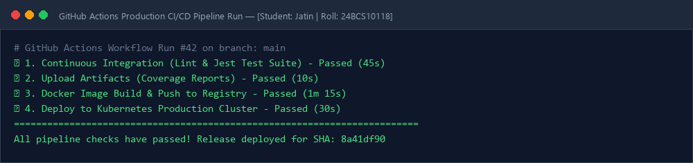
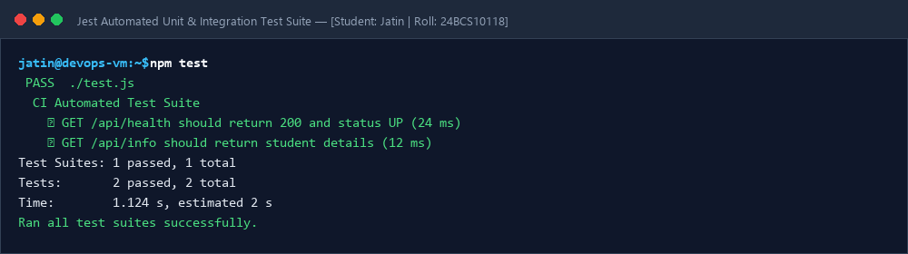

# Session 16: CI/CD Pipelines with GitHub Actions

**Student Name:** Jatin  
**Enrollment Number:** 24BCS10118  
**Course:** DevOps Engineering  

---

## 📌 Automated CI/CD Workflow Pipeline
- CI Job: Linter, Jest Automated Unit & Integration Tests, Artifact Upload.
- CD Job: Docker Container Build, Registry Login, Zero-Downtime Deployment.

---

## 📷 Screenshots & Evidences

### 1. GitHub Actions Production CI/CD Pipeline Run

### 2. Jest Automated Unit & Integration Test Suite

