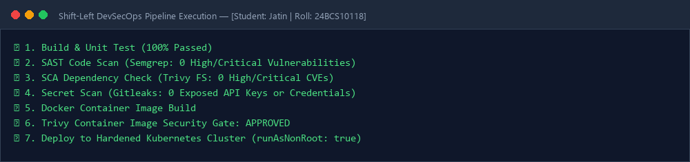
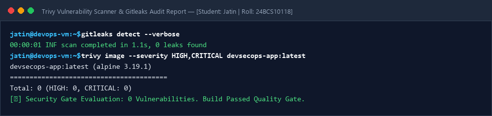

# Session 17: End-to-End CI/CD & DevSecOps Pipeline

**Student Name:** Jatin  
**Enrollment Number:** 24BCS10118  
**Course:** DevOps Engineering  

---

## 📌 Shift-Left DevSecOps Pipeline
- SAST (Semgrep / SonarQube)
- SCA (Trivy Dependency Analysis)
- Secret Scanning (Gitleaks)
- Container Image Vulnerability Scanning (Trivy Image)
- Security Quality Gate (Enforce 0 Critical CVEs)

---

## 📷 Screenshots & Evidences

### 1. Shift-Left DevSecOps Pipeline Execution (All Stages Green)

### 2. Trivy Vulnerability Scanner & Gitleaks Audit Report

