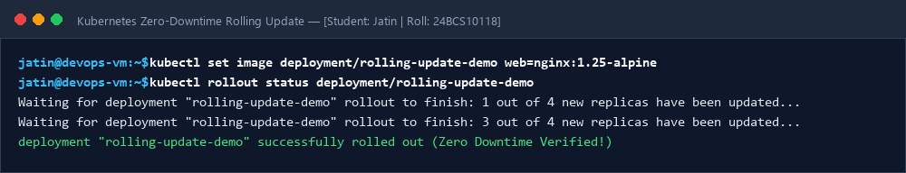
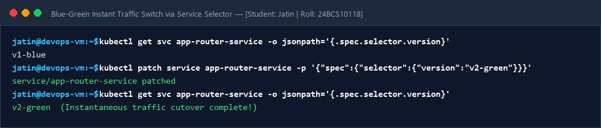
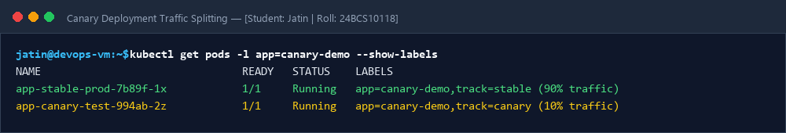
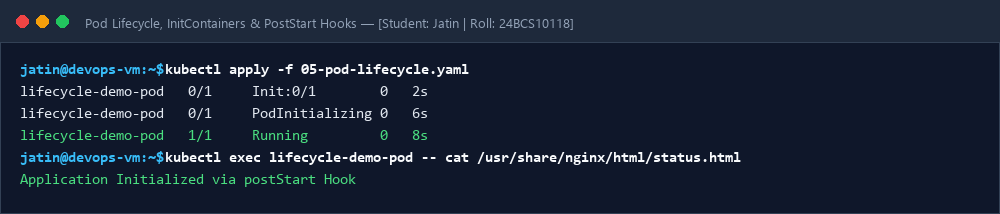

# Session 10: Kubernetes Pods, ReplicaSets & Deployment Strategies

**Student Name:** Jatin  
**Enrollment Number:** 24BCS10118  
**Course:** DevOps Engineering  

---

## 📌 4 Deployment Strategies & Pod Lifecycle Demonstrated

1. **Rolling Update (`01-rolling-update.yaml`):** Zero-downtime batch updates.
2. **Blue-Green (`02-blue-green.yaml`):** Instant traffic cutover via Service selector.
3. **Canary (`03-canary.yaml`):** 90/10 traffic split testing.
4. **Recreate (`04-recreate.yaml`):** Full teardown and redeploy.
5. **Pod Lifecycle (`05-pod-lifecycle.yaml`):** InitContainers, postStart hooks & probes.

---

## 📷 Screenshots & Evidences

### 1. Rolling Update Rollout Status

### 2. Blue-Green Instant Service Selector Switch

### 3. Canary Deployment Traffic Split Verification

### 4. Pod Lifecycle, Init Containers & PostStart Hook

