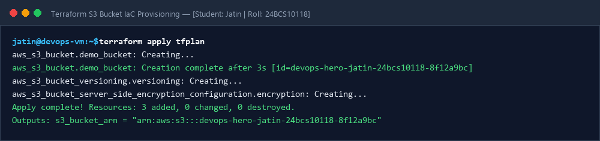
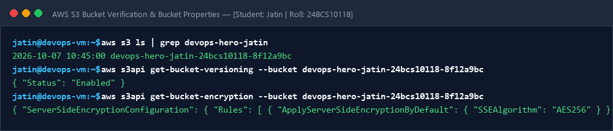

# Session 18: Infrastructure as Code (IaC) with Terraform & AWS Architecture

**Student Name:** Jatin  
**Enrollment Number:** 24BCS10118  
**Course:** DevOps Engineering  

---

## 📌 Task 1: Terraform S3 Infrastructure Project
- Project Directory: [`terraform-s3-demo/`](terraform-s3-demo/)
- Detailed execution guide: [`terraform-s3-demo/README.md`](terraform-s3-demo/README.md)
- Provisioned resources: `aws_s3_bucket`, `aws_s3_bucket_versioning`, `aws_s3_bucket_server_side_encryption_configuration`.

---

## 📌 Task 2: Comprehensive AWS Cloud Services Research
- 📖 [01 - AWS IAM](aws-services/01-iam/README.md)
- 📖 [02 - AWS EC2](aws-services/02-ec2/README.md)
- 📖 [03 - AWS S3](aws-services/03-s3/README.md)
- 📖 [04 - AWS VPC](aws-services/04-vpc/README.md)
- 📖 [05 - AWS DynamoDB & RDS](aws-services/05-dynamodb-rds/README.md)

---

## 📷 Screenshots & Evidences

### 1. Terraform Plan and Apply Terminal Outputs

### 2. AWS S3 Bucket Created & Properties Verified

