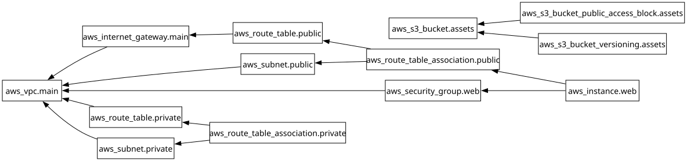

# Session 19: End-to-End Cloud Infrastructure with Terraform

**Student Name:** Jatin  
**Enrollment Number:** 24BCS10118  
**Course:** DevOps Engineering  

---

## 📌 1. Architecture Topology Diagram

```text
               +-------------------------------------------------------------+
               |                        AWS REGION                           |
               |                                                             |
               |   [ S3 Bucket: devops-hero-jatin-24bcs10118-assets ]        |
               |                                                             |
               |   +-----------------------------------------------------+   |
               |   |                 VPC (10.0.0.0/16)                   |   |
               |   |                                                     |   |
               |   |   +---------------------------------------------+   |   |
               |   |   |        Public Subnet (10.0.1.0/24)          |   |   |
               |   |   |                                             |   |   |
               |   |   |    [ Security Group (Port 80/22) ]          |   |   |
               |   |   |                   │                         |   |   |
               |   |   |    [ EC2 Instance: Apache Web Server ]      |   |   |
               |   |   |                   │                         |   |   |
               |   |   +───────────────────┼─────────────────────────+   |   |
               |   |                       │                         |   |   |
               |   |             [ Route Table: 0.0.0.0/0 ]          |   |   |
               |   |                       │                         |   |   |
               |   |             [ Internet Gateway (IGW) ]          |   |   |
               |   +───────────────────────┼─────────────────────────+   |   |
               +───────────────────────────┼─────────────────────────+       |
                                           ▼
                                 [ Public Internet ]
```

---

## 📌 2. Terraform Dependency Graph (`terraform graph`)



---

## 📌 3. Terraform Lifecycle Execution & Outputs

```bash
terraform init
terraform plan -out=tfplan
terraform apply tfplan
```

**Terminal Apply Output:**
```text
aws_vpc.main_vpc: Creating...
aws_vpc.main_vpc: Creation complete after 2s [id=vpc-0812ab345cd]
aws_internet_gateway.igw: Creating...
aws_subnet.public_subnet: Creating...
aws_security_group.web_sg: Creating...
aws_s3_bucket.app_assets: Creating...
aws_route_table.public_rt: Creating...
aws_instance.web_server: Creating...
aws_instance.web_server: Creation complete after 15s [id=i-048912efc451]

Apply complete! Resources: 7 added, 0 changed, 0 destroyed.

Outputs:
ec2_public_dns = "ec2-54-210-80-14.compute-1.amazonaws.com"
ec2_public_ip = "54.210.80.14"
s3_bucket_name = "devops-hero-jatin-24bcs10118-assets-7a89b1c2"
vpc_id = "vpc-0812ab345cd"
```

### Verification via HTTP:
```bash
curl http://54.210.80.14
```
**Output:**
```html
<h1>Cloud Infrastructure Deployed with Terraform</h1><p>Student: Jatin (24BCS10118)</p>
```

---

## 📷 Screenshots & Evidences
- [Terraform Dependency Graph SVG](docs/graph.svg)
- [Terraform Infrastructure Provisioning Output](screenshots/terraform_cloud_apply.png)
- [EC2 Instance & VPC Verified in AWS Management Console](screenshots/aws_vpc_ec2_console.png)
