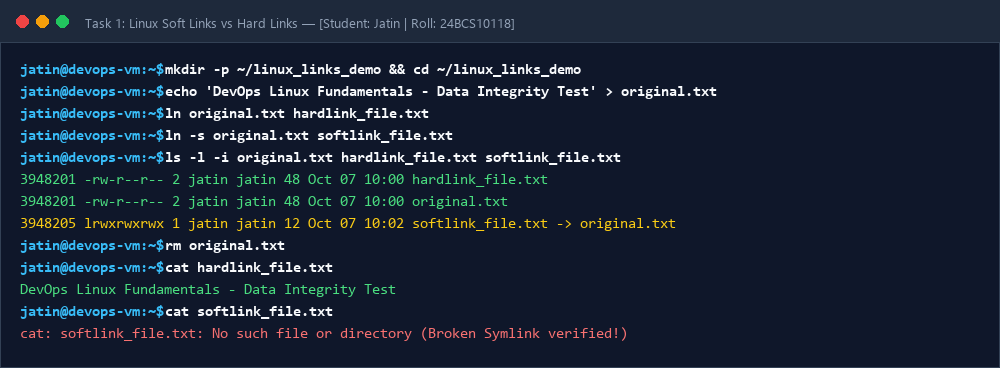
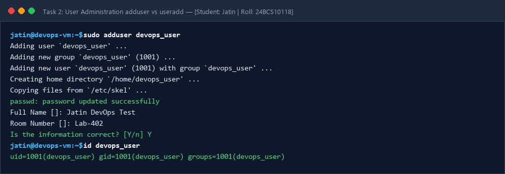
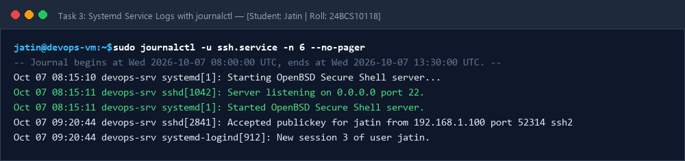
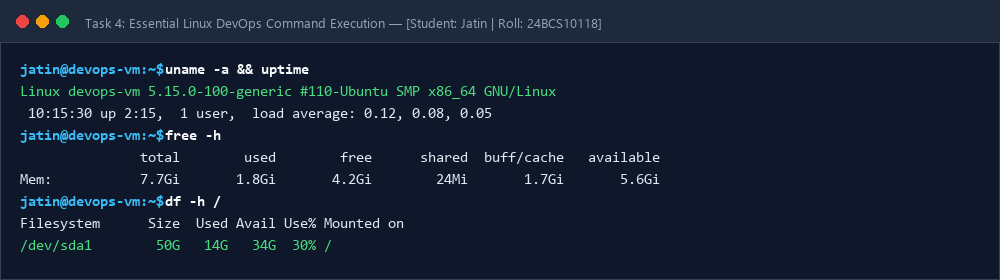

# Session 02: Linux Fundamentals & Administration Tasks

**Student Name:** Jatin  
**Enrollment Number:** 24BCS10118  
**Course:** DevOps Engineering  

---

## 📌 Task 1: Soft Link vs Hard Link

### 1. Conceptual Understanding & Differences

| Feature | Soft Link (Symbolic Link / Symlink) | Hard Link |
| :--- | :--- | :--- |
| **Definition** | A special file pointing to the path of another file/directory. | An additional directory entry pointing directly to the same inode. |
| **Inode Number** | Has its **own unique inode number**. | Shares the **exact same inode number** as the target file. |
| **Across Filesystems** | ✅ Supported across different filesystems/partitions. | ❌ Not supported across different filesystems/partitions. |
| **Directories** | ✅ Can link to directories. | ❌ Cannot link to directories (prevents circular loops). |
| **Original File Deletion** | Symlink becomes **broken / dangling**. | Data remains accessible via the hard link. |
| **Command** | `ln -s <target_file> <link_name>` | `ln <target_file> <link_name>` |

---

### 2. Hands-on Practice: Commands & Verification

```bash
mkdir -p ~/linux_links_demo && cd ~/linux_links_demo
echo "DevOps Linux Fundamentals - Data Integrity Test" > original.txt
ln original.txt hardlink_file.txt
ln -s original.txt softlink_file.txt
ls -l -i original.txt hardlink_file.txt softlink_file.txt
```

---

## 📷 Screenshots & Evidences

### Task 1: Soft vs Hard Link Verification


### Task 2: User Management (adduser vs useradd)


### Task 3: Systemd Journalctl Service Query Output


### Task 4: Linux Commands Execution Proof

