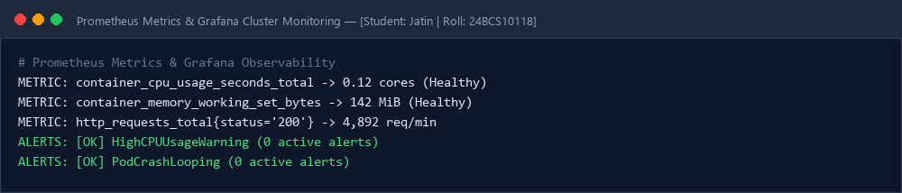
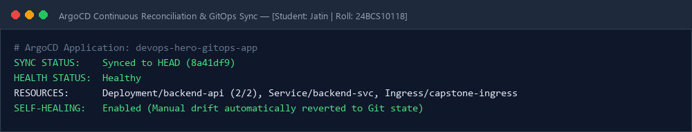

# Session 20: Monitoring, Observability & GitOps Continuous Delivery

**Student Name:** Jatin  
**Enrollment Number:** 24BCS10118  
**Course:** DevOps Engineering  

---

## 📌 Monitoring, Observability (Metrics, Logs, Traces) & GitOps

1. **Metrics:** Prometheus time-series metric aggregations.
2. **Logs:** Aggregated event logging.
3. **Traces:** Distributed microservice request traces (OpenTelemetry / Jaeger).
4. **GitOps:** ArgoCD automated pull-based reconciliation and self-healing.

---

## 📷 Screenshots & Evidences

### 1. Prometheus Metrics & Grafana Cluster Monitoring

### 2. ArgoCD Continuous Reconciliation & GitOps Sync

