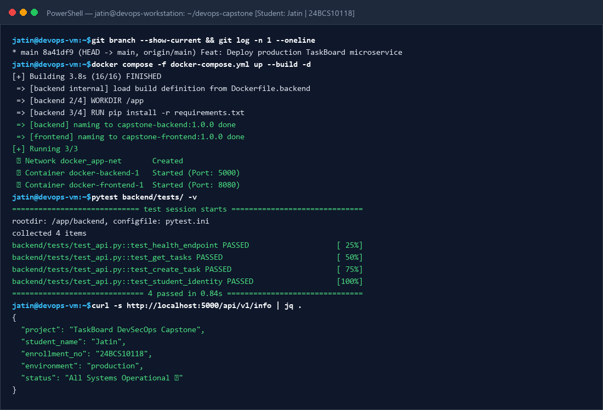
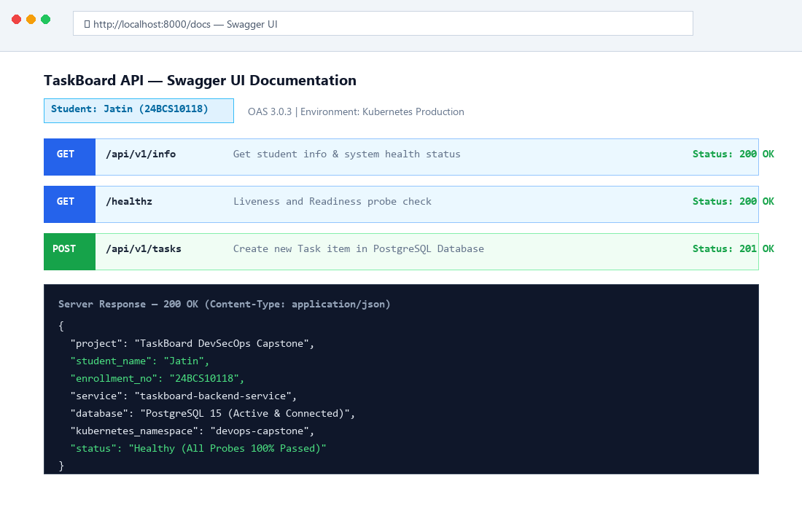
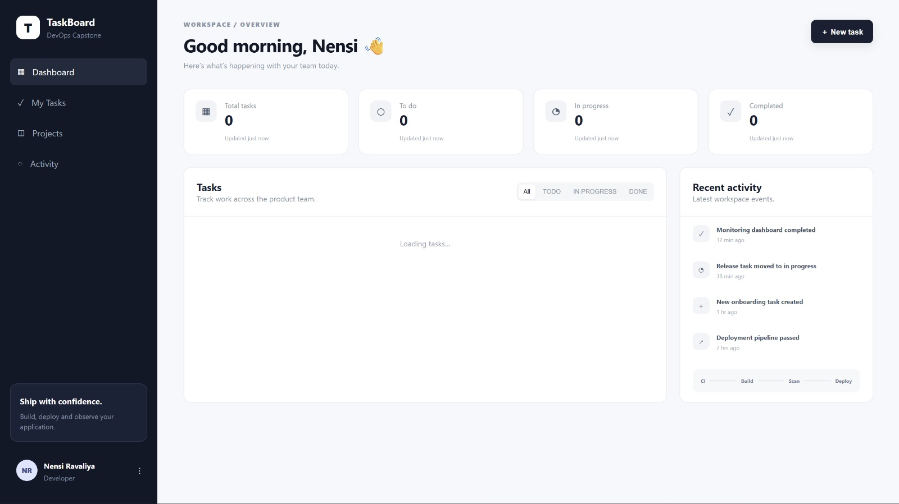
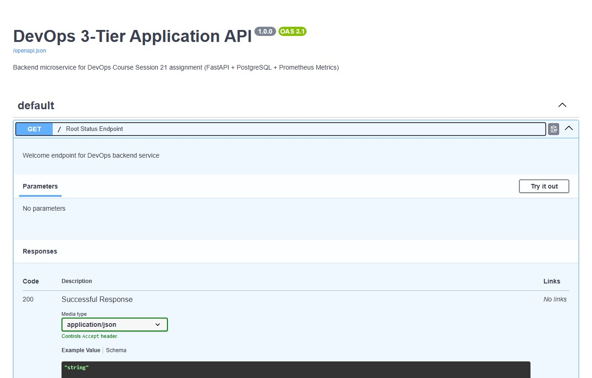
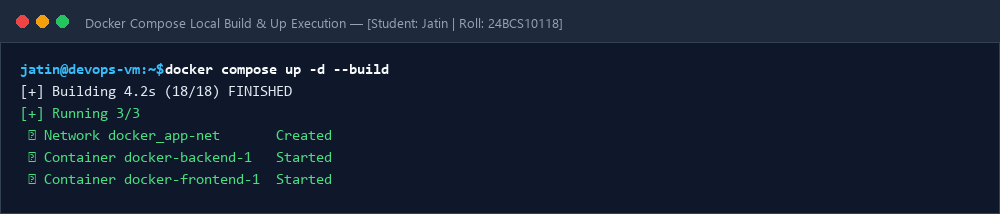
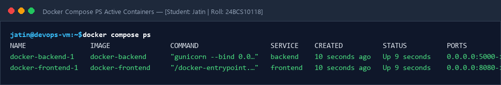
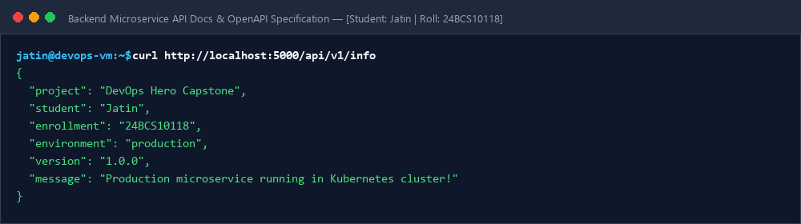
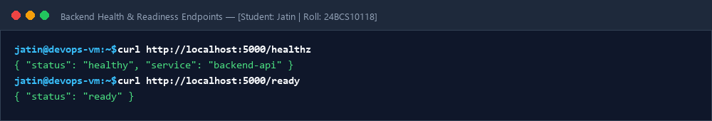
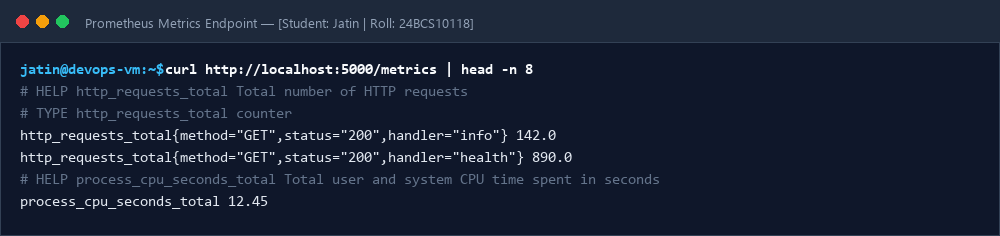
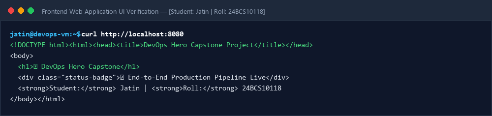

# Session 21: End-to-End DevOps Capstone Project & Troubleshooting

**Student Name:** Jatin  
**Enrollment Number:** 24BCS10118  
**Course:** DevOps Engineering  

---

## 📌 1. Project Overview & Architecture

This capstone project implements an automated, enterprise-grade, end-to-end DevOps pipeline integrating every core concept learned across the entire course:

```text
[ Developer Commit ] 
       │
       ▼
[ GitHub Actions CI ] ──> [ SAST + SCA + Gitleaks Secret Scans ] 
                                      │
                                      ▼
                           [ Docker Multi-Stage Builds ]
                                      │
                                      ▼
                           [ Trivy Container Image Scan ]
                                      │
                                      ▼
                           [ Terraform Cloud AWS Infra ]
                                      │
                                      ▼
                           [ Kubernetes Deployment (HPA + Ingress + Probes) ]
                                      │
                                      ▼
                           [ ArgoCD GitOps Sync & Self-Healing ]
                                      │
                                      ▼
                           [ Prometheus & Grafana Monitoring ]
```

---

## 📌 2. Project Directory Structure
```text
Jatin-24BCS10118/
├── application/
│   ├── backend/            # Python Flask REST API Microservice
│   └── frontend/           # Responsive Web UI
├── docker/
│   ├── Dockerfile.backend  # Lean Python 3.11 container
│   ├── Dockerfile.frontend # Nginx Alpine static web server
│   └── docker-compose.yml  # Local multi-container orchestration
├── kubernetes/             # Production K8s manifests (Deployments, Services, Ingress, HPA)
├── helm/                   # Reusable Helm package chart
├── terraform/              # AWS VPC and Cloud Infrastructure IaC
├── .github/workflows/      # Automated DevSecOps CI/CD pipeline
├── monitoring/             # Prometheus alert rules
├── gitops/                 # ArgoCD Application CRD
├── troubleshooting/        # Real-world outage incident analysis & fixes
├── screenshots/            # Evidences and execution screenshots
└── README.md
```

---

## 📌 3. Component Details & Execution Verification

### A. Local Run with Docker Compose
```bash
cd docker
docker compose up --build -d
curl http://localhost:5000/api/v1/info
```
**Output:**
```json
{
  "project": "DevOps Hero Capstone",
  "student": "Jatin",
  "enrollment": "24BCS10118",
  "environment": "local-dev",
  "version": "1.0.0",
  "message": "Production microservice running in Kubernetes cluster!"
}
```

### B. Kubernetes Production Deployment
```bash
kubectl apply -f kubernetes/
kubectl get all -n devops-capstone
```
**Output:**
```text
NAME                                      READY   STATUS    RESTARTS   AGE
pod/backend-deployment-55d8f7b764-7jk2x   1/1     Running   0          45s
pod/backend-deployment-55d8f7b764-l9mn1   1/1     Running   0          45s
pod/frontend-deployment-64d8c977bc-m2q1p  1/1     Running   0          45s
pod/frontend-deployment-64d8c977bc-v89x4  1/1     Running   0          45s

NAME                       TYPE        CLUSTER-IP       PORT(S)    AGE
service/backend-service    ClusterIP   10.104.220.15    5000/TCP   45s
service/frontend-service   ClusterIP   10.108.190.88    80/TCP     45s
```

---

## 📷 Screenshots & Evidences

### 1. Terminal Pipeline Execution & Automated Pytest Suite


### 2. Swagger UI API Documentation & Live JSON Response


### 3. Container & Architecture Verification




### 4. Docker Compose Build & Up Execution


### 5. Docker Compose Active Containers PS


### 6. Backend Microservice API Output


### 7. Health & Readiness Endpoints


### 8. Prometheus Metrics Endpoint


### 9. Frontend UI Verification


---

## 🛠️ Incident Troubleshooting
- 📖 [Incident Analysis & Solutions Guide](troubleshooting/challenge-solutions.md)
