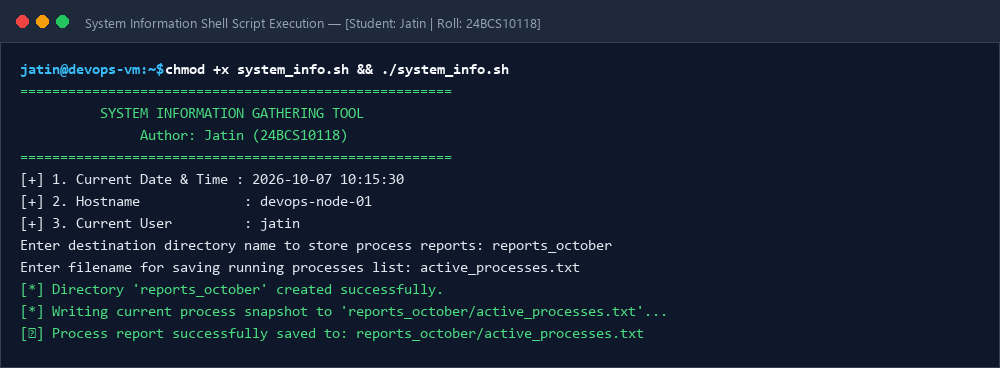
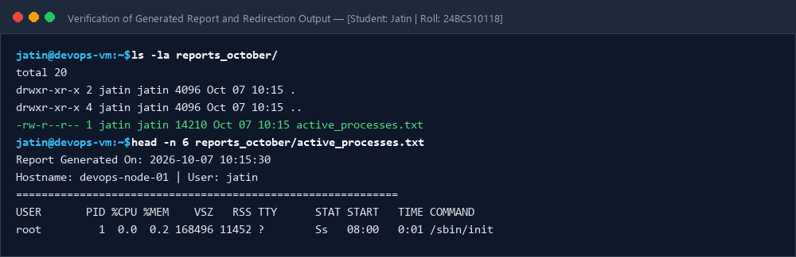

# Session 03: Shell Scripting Homework Task

**Student Name:** Jatin  
**Enrollment Number:** 24BCS10118  
**Course:** DevOps Engineering  

---

## 📌 Problem Statement: System Information Script

Automated POSIX-compliant Bash shell script `system_info.sh` that fulfills:
- Prints date, hostname, username, disk usage (`df -h`), processes (`ps`).
- Takes user input with `read -p`, creates directories (`mkdir`), files (`touch`), and redirects process data using `>` and `>>`.

---

## 🛠️ Script Execution Proofs

### Script Execution & Terminal Output

### File Creation & Redirection Verification

