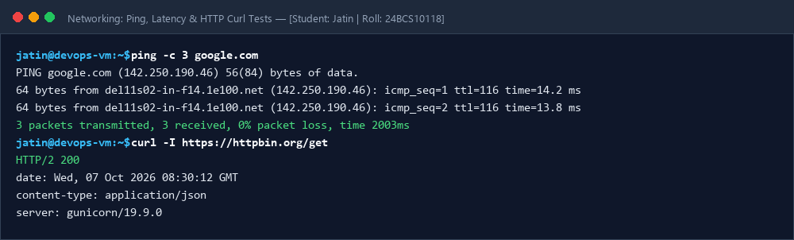
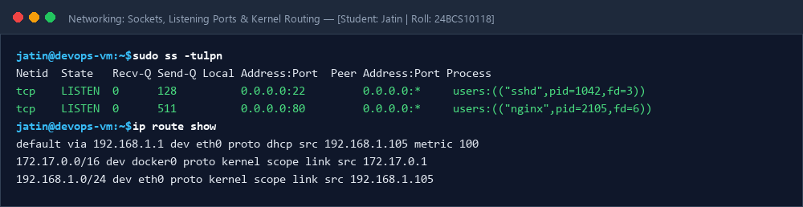
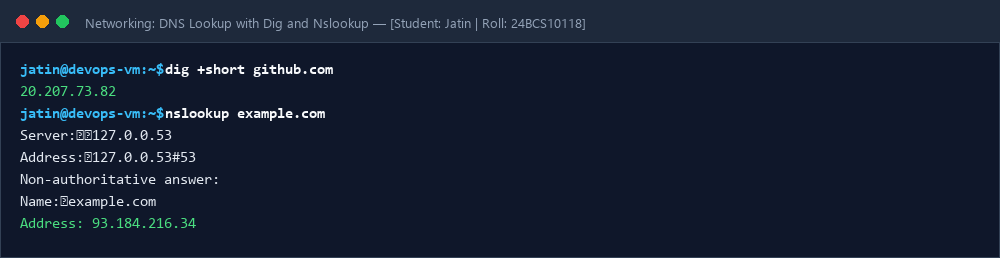

# Session 04: Networking Fundamentals & DevOps Commands

**Student Name:** Jatin  
**Enrollment Number:** 24BCS10118  
**Course:** DevOps Engineering  

---

## 🌐 Overview & Detailed Practical Log
- 📖 [Comprehensive Networking Practical Log & Subnetting Guide](NETWORKING.md)

---

## 📷 Screenshots & Evidences

### 1. Ping & Curl Command Execution Proof

### 2. Socket Statistics (`ss`) and Kernel Routing Table

### 3. DNS Lookup with Dig & Nslookup

