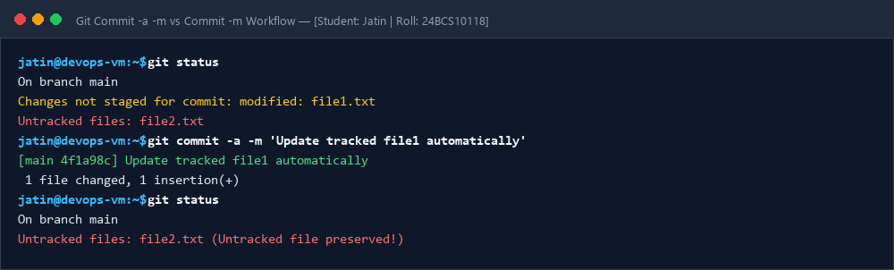
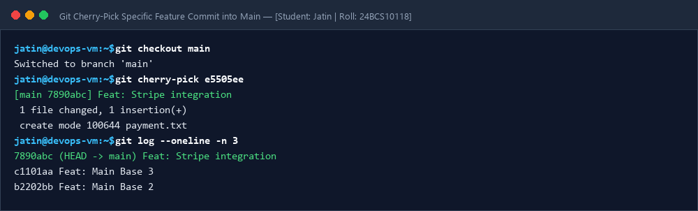

# Session 05: Git & Version Control Homework Tasks

**Student Name:** Jatin  
**Enrollment Number:** 24BCS10118  
**Course:** DevOps Engineering  

---

## 📌 Task 1: `git commit -a -m` vs `git commit -m`

| Feature | `git commit -m "message"` | `git commit -a -m "message"` |
| :--- | :--- | :--- |
| **Prerequisite** | Requires explicit staging using `git add <file>`. | Automatically stages tracked modified/deleted files before committing. |
| **Tracked Modified Files** | Will **NOT** commit unless previously staged. | ✅ Automatically staged and committed. |
| **Untracked (New) Files** | Will **NOT** commit untracked files. | ❌ Will **NOT** commit newly created untracked files. |

---

## 📷 Screenshots & Evidences

### Task 1: Commit -a -m vs Commit -m Workflow

### Task 2: Git Cherry-Pick Specific Feature Commit into Main

