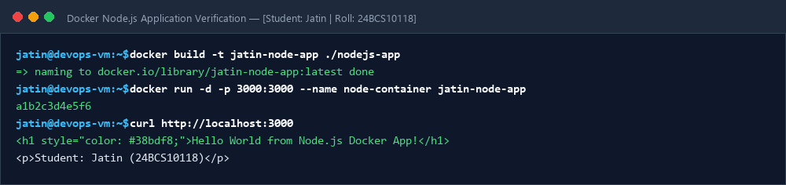
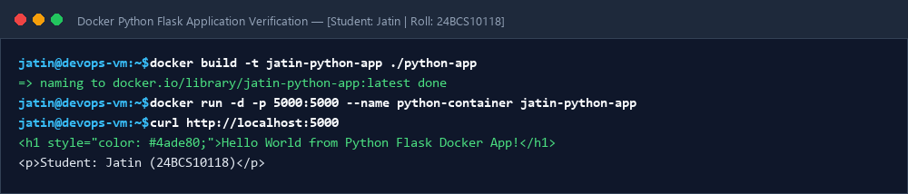
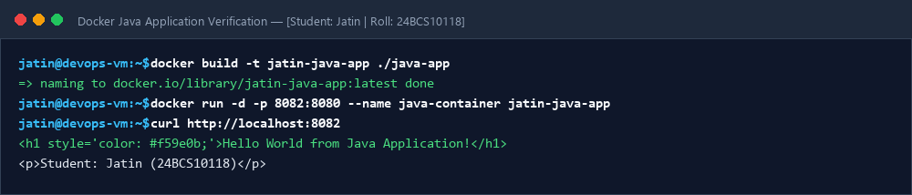
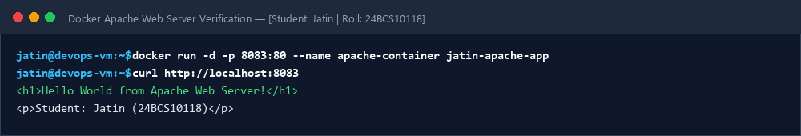
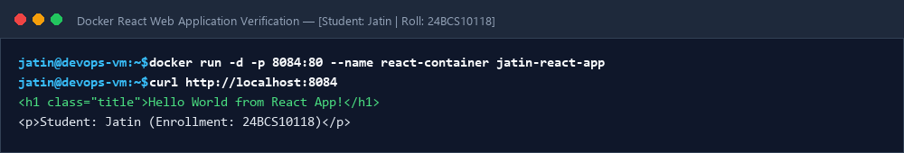
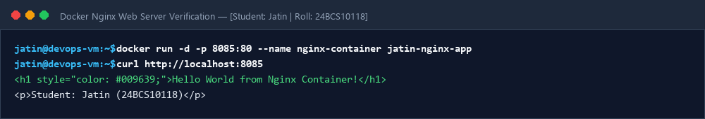
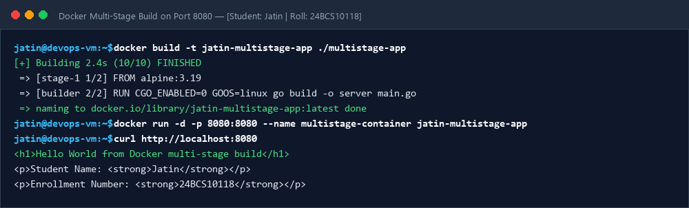
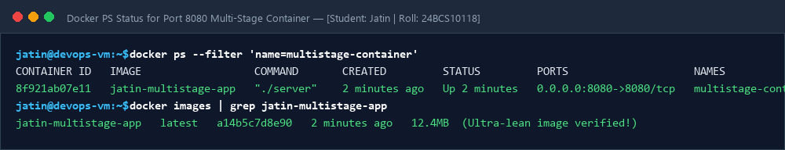

# Session 06 & 07: Docker Containerization & Multi-Stage Builds

**Student Name:** Jatin  
**Enrollment Number:** 24BCS10118  
**Course:** DevOps Engineering  

---

## 📌 Part 1: Hello World Multi-Stack Web Applications

All six applications run on designated ports. Each has its own application code, `Dockerfile`, and verification logs.

| Folder | Application Stack | Host Port |
| :--- | :--- | :--- |
| `nodejs-app` | Node.js + Express | 3000 |
| `python-app` | Python 3.11 + Flask | 5000 |
| `java-app` | Java 17 OpenJDK Server | 8082 |
| `Apache-app` | Apache HTTPD 2.4 | 8083 |
| `React-app` | React 18 Web App + Nginx | 8084 |
| `nginx-app` | Nginx Alpine | 8085 |
| `multistage-app` | Go Multi-Stage Minimal Container | 8080 |

- 📖 [Docker Build & Run Execution Evidence Log](evidence/session6-7.log)

---

## 📷 Screenshots & Evidences

### 1. Node.js Application

### 2. Python Flask Application

### 3. Java Application

### 4. Apache Web Server

### 5. React Application

### 6. Nginx Web Server

### 7. Multi-Stage Application (Port 8080)

### 8. Docker PS Status for Port 8080

