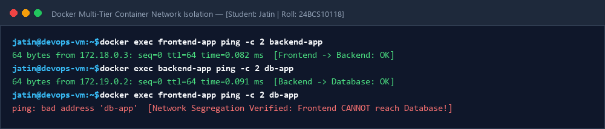
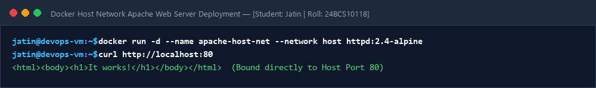
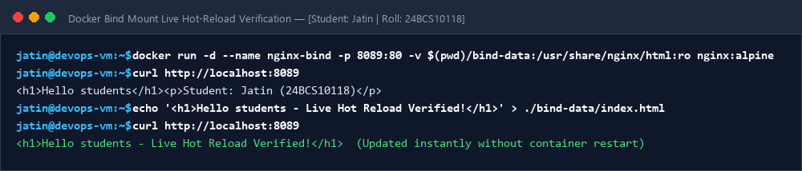

# Session 08: Docker Networking & Storage Volumes

**Student Name:** Jatin  
**Enrollment Number:** 24BCS10118  
**Course:** DevOps Engineering  

---

## 📌 Task 1: Multi-Tier Docker Container Networking

```text
[ frontend-app ] 
       │ (frontend-net)
[ backend-app  ] ── (db-net) ── [ db-app (MySQL) ]
```

---

## 📷 Screenshots & Evidences

### 1. Multi-Tier Container Network Connectivity & Isolation


### 2. Host Network Apache Deployment Output


### 3. Bind Mount Real-time Hot-Reload Verification

