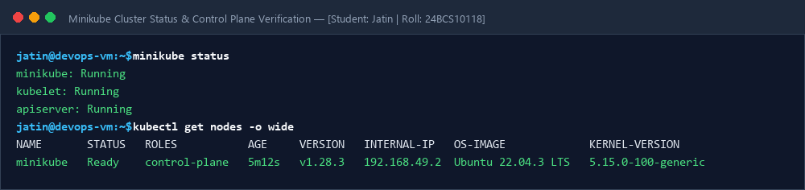
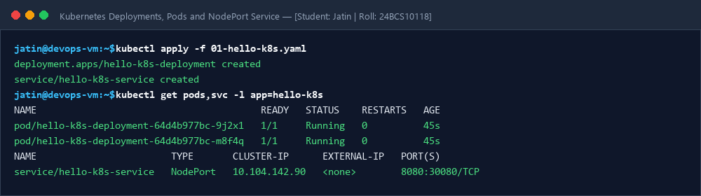

# Session 09: Kubernetes Fundamentals & Minikube Setup

**Student Name:** Jatin  
**Enrollment Number:** 24BCS10118  
**Course:** DevOps Engineering  

---

## 📌 1. Minikube Installation & Cluster Verification

Minikube is an open-source local Kubernetes engine that provisions a single-node or multi-node Kubernetes cluster inside a VM or container for testing and development.

---

## 📷 Screenshots & Evidences

### 1. Minikube Cluster-Info & Node Status

### 2. Deploying Pods & Service Exposure via NodePort

